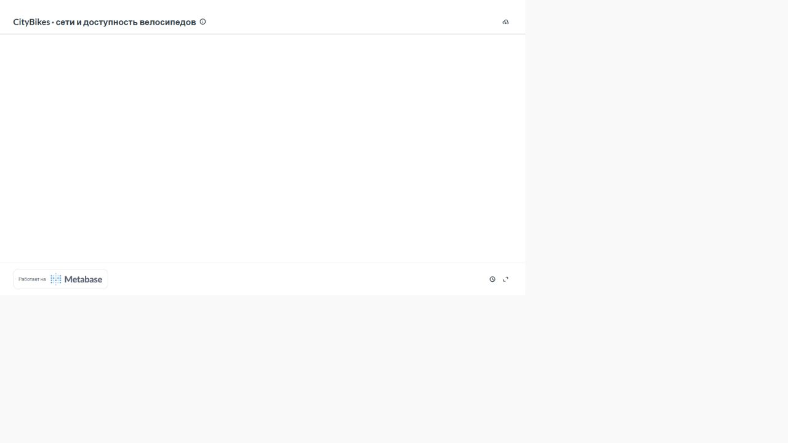
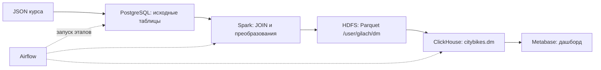
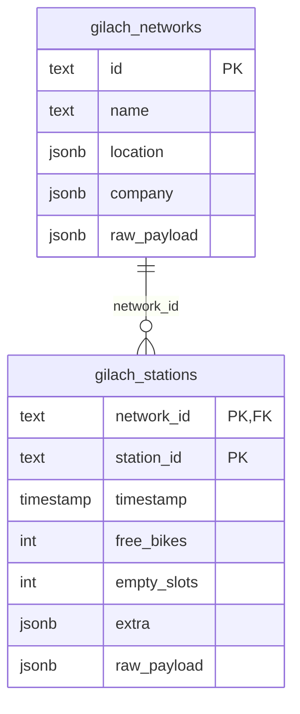

# CityBikes — ELT-конвейер и BI-дашборд

**Учебный проект инженера данных: JSON → PostgreSQL → Spark → HDFS → ClickHouse → Metabase.**

**Стек:** Apache Airflow · PySpark · PostgreSQL · Hadoop HDFS · ClickHouse · Metabase · Docker Compose.

**[Открыть публичный дашборд](https://5.23.55.6/public/dashboard/002795a3-c78a-46fd-9c15-6ec062e06689)**

## Что реализовано

- Один Airflow DAG управляет загрузкой JSON, преобразованиями в Spark, публикацией Parquet в HDFS, загрузкой ClickHouse и проверками качества.
- Сохраняются исходные JSON; загрузки можно повторять без накопления дублей.
- Промежуточные данные проверяются до публикации витрины.
- Метрики сверяются с исходными файлами; результат проверок сохраняется отдельно.

**Проверенный результат на учебном снимке:** 781 сеть, данные 598 станций трёх сетей, 1 376 строк итоговой витрины. Это снимок состояния, а не данные о поездках или динамике спроса.

**Ограничение:** развёрнутая конфигурация предназначена для демонстрации и обучения, а не для отказоустойчивой промышленной эксплуатации.

---
Учебный ELT-конвейер: JSON → PostgreSQL → Spark → HDFS → ClickHouse → Metabase. Все четыре этапа запускаются одним Airflow DAG `gilach_citybikes`.

Задание: https://app.simulative.ru/course/34/1364. Краткое условие — `ASSIGNMENT.md`.

**[Открыть дашборд без пароля](https://5.23.55.6/public/dashboard/002795a3-c78a-46fd-9c15-6ec062e06689)** · [Код DAG](https://github.com/GilachOne/simulative-citybikes/blob/main/dags/citybikes_dag.py)



## Результат и границы данных

Использованы файлы курса: каталог **781 сети** и **598 станций трёх сетей** (Abu Dhabi, Bergen, Beryl BCP). Данные станций относятся к **12 мая 2025 года**. Витрина содержит **1376 строк**: 598 станций и 778 сетей без загруженных станций.

По выборке: 1618 доступных велосипедов, 4108 свободных мест. Это состояние в момент снимка. **Число поездок, популярность и динамику по времени по этим файлам определить нельзя.** Отсутствующие сведения не заменены нулями. Столбец `bikes` источника соответствует `free_bikes`, `free` — `empty_slots`. Вместимость не вычисляется как простая сумма: в некоторых сетях есть самокаты и другие типы транспорта.

## Архитектура





### Этапы

1. **`json_to_postgres`** — создание схемы, проверка ключей и загрузка снимка в транзакции. Все поля сетей из файлов имеют колонки; исходные JSON также полностью сохранены в `raw_payload`. Станция определяется UID источника внутри сети; если UID нет, используется хеш имени и координат. Повторный запуск заменяет снимок без дублей.
2. **`spark_to_hdfs`** — left join по network_id, `from_json` с явными схемами, `trim`, числовые типы, UTC-время, `companies_count`, `network_station`. `extra.last_updated` поддерживает секунды Unix, миллисекунды Unix и строку даты. В Parquet сохраняются все нужные поля задания. Сети без станций остаются в витрине. Новый результат проверяется в staging-каталоге HDFS, затем публикуется; предыдущий сохраняется в `_previous`.
3. **`hdfs_to_clickhouse`** — чтение Parquet именно из HDFS и вставка пакетами в промежуточную таблицу. После сверки количества `EXCHANGE TABLES` атомарно заменяет витрину. Массивы `company`/`payment` хранятся как Array(String); отсутствующий массив в ClickHouse становится пустым, а остальные nullable-поля сохраняют NULL.
4. **`quality_checks`** — число сетей/станций и суммы сверяются с исходными JSON; результат записывается в `evidence/verification.json`.

Полный DAG запускался повторно: итоговые количества и суммы не изменились. Отдельно проверены эквивалентные даты Unix seconds, Unix milliseconds, ISO UTC, ISO с часовым поясом и отсутствующее значение.

Префикс `gilach_` соответствует учебному GitHub-аккаунту. Путь HDFS: `/user/gilach/dm`.

## Файлы

- `dags/citybikes_dag.py` — граф Airflow.
- `pipeline.py` — загрузка и преобразования.
- `sql/schema.sql` — схема PostgreSQL с PK/FK/CHECK.
- `compose.yaml`, `Dockerfile`, `hadoop/`, `clickhouse/` — окружение.
- `download_data.py` — скачивание точных файлов курса и SHA-256 манифест.
- `metabase_setup.py` — создание вопросов и дашборда через API.
- `evidence/` — результаты реального запуска и проверки запросов.

## Воспроизведение

Нужны Docker Compose, интернет и Python 3 с `requests` для скачивания данных. На небольшом VPS тяжёлые работы запускаются по очереди; рекомендуются 4 ГБ RAM и запас swap. Базы и HDFS не имеют публичных портов. ClickHouse доступен на `127.0.0.1:8124`, Airflow UI — на `127.0.0.1:8082`.

```bash
python -m pip install requests
python download_data.py
python init_env.py
docker compose build
mkdir -p evidence work
# Linux: контейнер Airflow работает с UID 50000
sudo chown -R 50000:0 evidence work
docker compose up -d postgres namenode datanode clickhouse
docker compose run --rm airflow bash -c 'airflow db migrate && python run_checks.py'
```

Первые запуски HDFS могут потребовать несколько секунд на выход из safe mode. Итог успешной проверки — `CITYBIKES DAG VERIFIED`. Повтор той же команды обрабатывает тот же снимок; количество строк остаётся неизменным. HDFS можно проверить командой:

```bash
docker compose exec namenode hdfs dfs -ls /user/gilach/dm
```

Для просмотра графа локально: `docker compose up -d airflow`. Airflow standalone создаёт локальную учётную запись; пароль смотрите в локальных логах и не публикуйте. Он не включён в GitHub.

## Metabase

Использован официальный встроенный [ClickHouse-драйвер Metabase](https://www.metabase.com/docs/latest/databases/connections/clickhouse).

Сначала создаётся отдельный пользователь БД только на чтение:

```bash
docker compose run --rm --no-deps airflow bash -c 'python setup_reader.py'
```

Затем `metabase_setup.py` запускается на хосте Metabase с переменными `MB_ADMIN_EMAIL`, `MB_ADMIN_PASSWORD`, `CH_READER_PASSWORD`; опционально `METABASE_URL`, `METABASE_PUBLIC_URL`, `MB_CH_HOST`, `MB_CH_PORT`. Пароли берутся из локального окружения, не передаются через GitHub. Для демо в Metabase должна быть включена публичная публикация. Скрипт создаёт отдельную коллекцию и 11 вопросов, проверяет каждый запрос и сохраняет публичную ссылку в `evidence/dashboard.json`.

Графики отдельно показывают весь каталог сетей и ограниченную выборку станций. Оплата может иметь несколько способов на одной станции, поэтому суммы столбцов не равны числу станций. Наличие электровелосипедов разделено на подтверждённое, отрицательное и неизвестное.

## Ограничения учебной установки

HDFS имеет одну реплику и отключённые файловые разрешения **только во внутренней Docker-сети**. Airflow использует SQLite и последовательный исполнитель. Это не отказоустойчивый production-кластер. Чтение исходных таблиц в Spark идёт через Python-драйвер и подходит для объёма задания; для больших данных нужен JDBC с партиционированием. Гарантия атомарности действует отдельно на PostgreSQL и ClickHouse, общей транзакции между системами нет. HDFS-публикация через rename имеет краткий промежуток между переименованиями; DAG запускается последовательно.

После проверки тяжёлые сервисы можно остановить: `docker compose stop airflow postgres namenode datanode`. ClickHouse оставляют включённым, пока нужен дашборд. `docker compose stop` сохраняет именованные тома.
